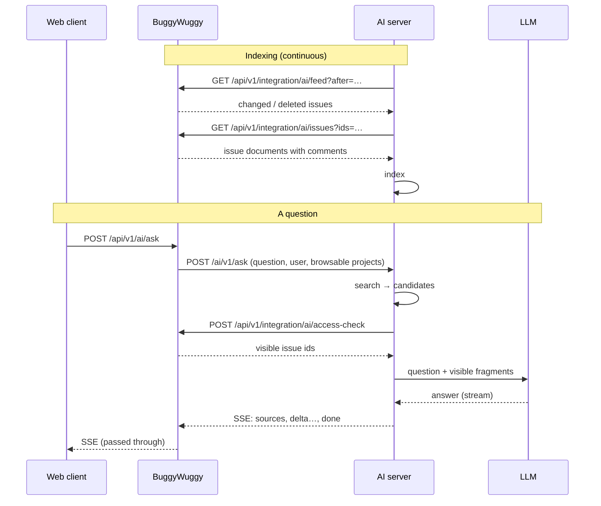

# AI Integration

Status: draft · Last updated: 2026-11-18 · See also: [domain-model.md](domain-model.md)

BuggyWuggy can be connected to an **AI server** that answers questions in natural language
from the knowledge in the issue history (retrieval-augmented generation), with references to
the issues it used and an indication of how reliable the answer is. Users ask through an AI
button in the web client.

The AI server is optional and a separate program. BuggyWuggy contains only the integration
described here: the button, the endpoints that forward questions, and a read-only API from
which an AI server builds its index. Any AI server that implements §4 can be used. The
BuggyWuggy project offers one as a commercial product (the *BuggyWuggy AI Server*), but this
interface does not depend on it.

## Contents

1. [Principles](#1-principles)
2. [Overview](#2-overview)
3. [Conventions](#3-conventions)
4. [AI server API](#4-ai-server-api-implemented-by-the-ai-server)
5. [Integration API](#5-integration-api-implemented-by-buggywuggy)
6. [Confidence](#6-confidence)
7. [Client API](#7-client-api-implemented-by-buggywuggy)
8. [Data protection](#8-data-protection)
9. [Open questions](#9-open-questions)

## 1. Principles

1. **Two programs, one HTTP boundary.** The AI server is a separate process that talks to
   BuggyWuggy only over the HTTP APIs in this document.
2. **The browser never talks to the AI server.** The web client calls BuggyWuggy; BuggyWuggy
   authenticates the user and forwards the question. The AI server needs to be reachable only
   from the BuggyWuggy server (internal network or localhost).
3. **BuggyWuggy owns permissions.** The AI server never decides what a user may see. It asks
   BuggyWuggy (§5.3), so project roles, `REPORTER`/`ASSIGNEE` grants and (later) restricted
   comments keep working without being duplicated.
4. **The AI server has its own store.** It keeps a copy of the issue texts in its own store,
   fed by the export and change feed of §5. It never reads BuggyWuggy's tables, so
   BuggyWuggy's schema stays free to change.
5. **Optional.** Without a configured AI server, BuggyWuggy behaves exactly as without this
   feature: no button, no change feed, no extra load.
6. **Honest confidence.** The reliability indication is derived from measurable signals (§6),
   and it is presented as a probability only once user feedback supports it.

## 2. Overview



## 3. Conventions

| Topic | Convention |
|---|---|
| Transport | HTTPS, or plain HTTP on localhost / a private network. JSON with UTF-8. |
| Naming | camelCase JSON properties; timestamps ISO-8601 in UTC (`2026-11-18T14:03:00Z`). |
| Versioning | BuggyWuggy endpoints under `/api/v1/…`, AI server endpoints under `/ai/v1/…`. Additive changes (new optional properties, new event types) keep the version; receivers ignore unknown properties. |
| Errors | RFC 9457 `application/problem+json`, with a `code` property (a message key such as `ai.unavailable`), as in the rest of BuggyWuggy's API. |
| Streaming | Server-Sent Events (`text/event-stream`). |
| Identifiers | Issue and comment ids are BuggyWuggy's numeric ids (stable when an issue moves to another project; the key is not). |

### 3.1 Authentication between the servers

Two independent secrets, one per direction, so a leak of one does not open both:

| Direction | Header | Where it is configured |
|---|---|---|
| BuggyWuggy → AI server | `Authorization: Bearer <AI server API key>` | Issued by the AI server; entered in BuggyWuggy's administration (*Administration → AI*). |
| AI server → BuggyWuggy | `Authorization: Bearer <integration token>` | Generated in BuggyWuggy's administration (shown once, stored hashed); entered in the AI server's configuration. |

The integration token gives access to `/api/v1/integration/ai/**` only, and only to reading.
It is not a user session: no CSRF, no two-factor login. BuggyWuggy rejects it on every other
path.

## 4. AI server API (implemented by the AI server)

Base path `/ai/v1`. Called only by BuggyWuggy.

### 4.1 `GET /ai/v1/status`

Used by BuggyWuggy to decide whether to show the AI button, and on the administration page.

```json
{
  "apiVersion": 1,
  "product": "BuggyWuggy AI Server",
  "serverVersion": "1.0.0",
  "ready": true,
  "reason": null,
  "index": {
    "issues": 18234,
    "lastSyncAt": "2026-11-18T14:02:51Z",
    "state": "UP_TO_DATE"
  },
  "languages": ["en", "nl"],
  "details": { }
}
```

- `ready`: questions can be answered. When `false`, `reason` is a message key the client
  translates (`ai.index.empty`, `ai.model.loading`, `ai.license.invalid`, …) and the AI button
  is shown disabled with that reason.
- `index.state` ∈ `EMPTY`, `INITIAL_LOAD` (with `progress` 0–1), `CATCHING_UP`, `UP_TO_DATE`,
  `ERROR` (with `message`).
- `details`: free-form key/value pairs of the AI server (models, license, …), shown as is on
  the administration page.

### 4.2 `POST /ai/v1/ask`

```json
{
  "requestId": "6f1c2a9e-3b0d-4c1e-9a77-0d2b5c1e8f40",
  "question": "Waarom mislukt de import van Jira-bijlagen met een 403?",
  "language": "nl",
  "user": { "id": 42 },
  "scope": {
    "projectIds": [3, 7, 12],
    "contextIssueId": 9812
  },
  "options": { "maxSources": 6, "stream": true }
}
```

| Property | Notes |
|---|---|
| `requestId` | Generated by BuggyWuggy; used in logs, in the access check (§5.3) and for feedback. |
| `question` | 1–2000 characters, plain text. |
| `language` | The user's language; the answer is written in it. |
| `user.id` | Only an id: names and e-mail addresses of users are never sent. |
| `scope.projectIds` | Projects the user may browse through any holder type, including projects where the user only sees issues they reported or are assigned to; narrowed to one project when the user chose one. A coarse pre-filter for the search; the exact check is §5.3. |
| `scope.contextIssueId` | Optional: the issue that was open when the button was pressed. Used to find related issues and as extra context ("is this a known problem?"). |
| `options.maxSources` | 1–10, default 6: how many issues may be used for the answer. |

**Response with `stream: true`** — `text/event-stream`, events in this order:

```
event: queued
data: {"position":2}

event: sources
data: {"sources":[{"issueId":9640,"issueKey":"IMP-311","summary":"Jira attachments: 403 with API token","status":"Resolved","resolution":"Fixed","resolvedAt":"2026-09-02T10:11:00Z","relevance":0.83,"fragments":[{"commentId":55120,"text":"De Jira Cloud API geeft 403 als …"}]}]}

event: delta
data: {"text":"Dit is een bekend probleem: "}

event: delta
data: {"text":"Jira Cloud weigert bijlagen te leveren als …"}

event: done
data: {"answerId":"a_01JD3…","confidence":{…},"citations":[{"issueId":9640,"marker":1}]}
```

- `queued` (optional, repeated): the question waits for the model; `position` is its place
  in the queue.
- `sources` comes before the answer, so the client can show the issues while the answer is
  written. `fragments[].commentId` is `null` for a fragment of the summary or description.
- The answer text is Markdown and refers to sources with markers `[1]`, `[2]`, matching
  `citations[].marker` (numbered in the order of `sources`).
- Only issues and comments that passed the access check (§5.3) may be shown or used for the
  answer. BuggyWuggy checks `sources` against the same rules before passing them on, and
  stops the stream with `ai.sources.forbidden` if one fails.
- If nothing relevant is found, `sources` is empty and the answer says so.
- `confidence`: see §6.
- On an error halfway: `event: error` with a problem object; the stream ends.

**Response with `stream: false`** — one JSON object with `answerId`, `answer`, `sources`,
`citations` and `confidence`.

**Errors:** `400 ai.question.invalid`, `401` (wrong API key), `429 ai.busy` (queue full, with
`Retry-After`), `503 ai.unavailable` (with the reason of §4.1), `504 ai.timeout`.

### 4.3 `POST /ai/v1/answers/{answerId}/feedback`

```json
{ "user": { "id": 42 }, "rating": "UP", "remark": "Klopte, opgelost met nieuw token." }
```

`rating` ∈ `UP`, `DOWN`; `remark` optional, at most 1000 characters. One rating per answer per
user; a new one replaces it. Response `204`. Used to calibrate the confidence (§6).

### 4.4 `POST /ai/v1/index/rebuild`

Starts a full re-index. Response `202` with the new `index` object of §4.1. Administrators
only, through BuggyWuggy's administration page.

## 5. Integration API (implemented by BuggyWuggy)

Base path `/api/v1/integration/ai`. Called only by the AI server with the integration token
(§3.1). Read-only.

### 5.1 `GET /api/v1/integration/ai/issues`

Paged export of issue documents, for the initial load and for fetching changed issues.

Parameters: either `afterId` (keyset paging over all issues, ordered by id; leave it out for
the first page) with `limit` (1–500, default 100), or `ids` (comma-separated, at most 500).

```json
{
  "items": [
    {
      "id": 9640,
      "key": "IMP-311",
      "project": { "id": 7, "key": "IMP", "name": "Importers", "archived": false },
      "type": "Bug",
      "status": { "name": "Resolved", "category": "DONE" },
      "resolution": "Fixed",
      "priority": "High",
      "labels": ["jira", "attachments"],
      "components": ["Jira importer"],
      "fixVersions": ["1.4.0"],
      "parentId": null,
      "reporterId": 18,
      "assigneeId": 4,
      "summary": "Jira attachments: 403 with API token",
      "description": "Markdown …",
      "createdAt": "2026-08-30T08:12:00Z",
      "updatedAt": "2026-09-02T10:11:00Z",
      "resolvedAt": "2026-09-02T10:11:00Z",
      "links": [{ "type": "Duplicate", "direction": "INWARD", "issueId": 9702 }],
      "comments": [
        {
          "id": 55120,
          "authorId": 4,
          "body": "Markdown …",
          "createdAt": "2026-09-01T15:40:00Z",
          "updatedAt": "2026-09-01T15:40:00Z",
          "visibility": null
        }
      ]
    }
  ],
  "nextAfterId": 9640,
  "feedCursor": "0000000000a1f3c2"
}
```

- Users appear only as ids. Names, e-mail addresses and attachments are not exported.
- `visibility` is always `null` for now; it is there for restricted comments (planned, see
  [domain-model.md §11](domain-model.md#11-planned-later-designed-for-not-built)). An AI
  server must treat an unknown non-null value as "do not use".
- `nextAfterId` is `null` on the last page.
- `feedCursor` is only on the first page of an `afterId` export: the position of the change
  feed when the export started. The AI server continues the feed (§5.2) from there after the
  export, so nothing changed during the export is missed.
- With `ids`, ids that do not exist (any more) are left out.

### 5.2 `GET /api/v1/integration/ai/feed`

The change feed: which issues changed or disappeared since a cursor.

Parameters: `after` (cursor from a previous response or from §5.1), `limit` (1–1000,
default 500).

```json
{
  "events": [
    { "issueId": 9640, "kind": "CHANGED", "at": "2026-11-18T14:02:40Z" },
    { "issueId": 9122, "kind": "DELETED", "at": "2026-11-18T14:02:44Z" },
    { "projectId": 7, "kind": "PROJECT_CHANGED", "at": "2026-11-18T14:02:50Z" }
  ],
  "cursor": "0000000000a1f3d0",
  "more": false
}
```

| `kind` | Meaning | Expected action of the AI server |
|---|---|---|
| `CHANGED` | The issue, or one of its comments, was created, changed or deleted, or the issue moved to another project | Fetch it with §5.1 `ids` and replace what it indexed of it |
| `DELETED` | The issue was deleted | Remove it |
| `PROJECT_CHANGED` | Project renamed, re-keyed, archived or unarchived | Update the project data of its issues |
| `PROJECT_DELETED` | Project and all its issues were deleted | Remove all issues of the project |

Events only say *what* changed; the content is always fetched fresh. Several events for the
same issue may be collapsed. Permission changes (roles, groups, schemes) produce no events:
they do not change what is indexed, only who may see it, and that is checked per question.

**Implementation.** A table `integration_change(seq bigint identity, xid xid8, kind,
issue_id, project_id, at)` is written in the same transaction as the change, next to where
history and outbox events are written. A plain sequence is not a safe cursor: a transaction
that took a lower number may commit after one with a higher number. The feed therefore only
returns rows whose transaction is older than every transaction still running
(`xid < pg_snapshot_xmin(pg_current_snapshot())`), so a cursor never skips a row. Rows older
than 30 days are removed; a cursor older than that gets `410 ai.feed.expired`, after which
the AI server does a full export again. The table is only written while an AI server is
configured.

**Polling.** The AI server decides how often it polls (10 seconds is a sensible default).
*(later)* BuggyWuggy sends a hint (`POST /ai/v1/hint`, no body) when the feed has new rows.

### 5.3 `POST /api/v1/integration/ai/access-check`

Which of the candidate issues and comments the user may see, by BuggyWuggy's own rules.

```json
{
  "requestId": "6f1c2a9e-3b0d-4c1e-9a77-0d2b5c1e8f40",
  "userId": 42,
  "issueIds": [9640, 9702, 9122, 8811],
  "commentIds": [55120, 55121]
}
```

```json
{ "issueIds": [9640, 9702, 8811], "commentIds": [55120, 55121] }
```

- At most 200 issue ids and 1000 comment ids per call.
- A comment is visible when its issue is visible and (later) its visibility restriction
  allows it.
- BuggyWuggy only accepts a `requestId` of a question it forwarded in the last 10 minutes,
  with the same `userId`, so the integration token cannot be used to probe the rights of
  arbitrary users.

An AI server typically retrieves more candidates than it needs (e.g. 40), checks them in one
call and uses the best visible ones.

## 6. Confidence

```json
"confidence": {
  "level": "HIGH",
  "score": 0.78,
  "calibrated": false,
  "signals": ["STRONG_MATCH", "RESOLVED_SOURCES", "SOURCES_AGREE"]
}
```

| Property | Meaning |
|---|---|
| `level` | `HIGH`, `MEDIUM`, `LOW` or `NONE` (nothing relevant found). What the client shows. |
| `score` | 0–1. While `calibrated` is `false` a relative score, not a probability; the client does not show it then. |
| `calibrated` | `true` when the AI server has fitted `score` to user feedback (§4.3): `score` is then the estimated chance that a user rates the answer as correct, and the client shows it as a percentage. |
| `signals` | Codes explaining the level; the client translates the known ones and ignores others. |

Known signal codes:

| Code | Meaning |
|---|---|
| `STRONG_MATCH` / `WEAK_MATCH` | The best sources match the question well / poorly. |
| `RESOLVED_SOURCES` | The best sources were resolved as fixed or done. |
| `UNRESOLVED_SOURCES` | The best sources are still open: the problem is known, a solution may not be. |
| `SOURCES_AGREE` / `SOURCES_DISAGREE` | Several sources point to the same cause or solution / contradict each other. |
| `OLD_SOURCES` | The best sources are old. |
| `FEW_SOURCES` | Fewer than two relevant sources. |
| `ANSWER_GROUNDED` / `ANSWER_UNGROUNDED` | The claims in the answer do / do not appear in the cited fragments. |

How the level and score are computed is up to the AI server.

## 7. Client API (implemented by BuggyWuggy)

Endpoints for the web client, with BuggyWuggy's usual session authentication and CSRF.

| Endpoint | Behaviour |
|---|---|
| `GET /api/v1/ai/status` | `{ "enabled": true, "available": true, "reason": null }`. `enabled`: an AI server is configured and the user has `USE_AI`. `available`: its status says `ready`; otherwise `reason` from §4.1. Cached for 30 seconds. With `enabled: false` the client shows no button. |
| `POST /api/v1/ai/ask` | Body `{ "question", "projectId"?, "contextIssueKey"? }`. BuggyWuggy adds the user id, language, browsable projects and a `requestId`, forwards to §4.2 and passes the event stream through after checking `sources` (§4.2). Rate limit per user (default 20 questions per hour). |
| `POST /api/v1/ai/answers/{answerId}/feedback` | Body `{ "rating", "remark"? }`; forwarded to §4.3 with the user's id. |
| `GET/PUT /api/v1/admin/ai` | Administration: AI server URL, API key (write-only), rate limit; shows the AI server's status (§4.1). |
| `POST /api/v1/admin/ai/token` | Generates a new integration token (shown once) and revokes the previous one. `DELETE` revokes it. |
| `POST /api/v1/admin/ai/rebuild` | Forwarded to §4.4. |

New global permission `USE_AI` (granted to group `users` by default), so an installation can
limit who may ask questions.

**Web client.** An AI button in the top bar opens a prompt window: a question field, an
optional project choice (default: all projects; the current project when opened from one) and,
on an issue page, the option to ask about that issue. The answer is shown as it streams in,
with the sources as links to their issues, the confidence level and its signals, and 👍/👎.

## 8. Data protection

- BuggyWuggy sends issue texts, comments and user **ids** to the AI server; no names, e-mail
  addresses or attachments. Names written in issue texts themselves are sent as they are.
- The administration page states which AI server is connected and, from its status
  `details`, whether it sends data to an external service.
- When an issue is deleted in BuggyWuggy, the AI server learns so through the change feed
  (§5.2) and is expected to remove it promptly.

## 9. Open questions

1. Follow-up questions in a conversation (`conversationId`).
2. Whether attachments (text files, logs) should be exported for indexing.
3. Webhooks (planned) as an alternative to polling the change feed.
